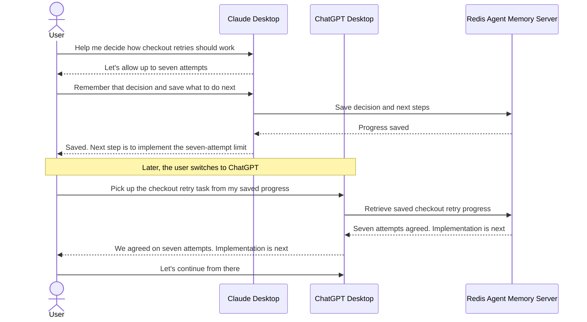

# Redis Agent Memory for Claude and ChatGPT

Persistent project memory across chats, coding sessions, and agent handoffs.

Give Claude Desktop and ChatGPT Desktop a durable project memory backed by Redis Agent Memory. The project keeps useful context available across new chats and agent handoffs, without making people repeat the project history every time.

Configured local Claude Code and ChatGPT/Codex projects automatically save submitted prompts and available final responses to ordered Redis sessions and searchable long-term memory, with a local retry queue for outages. Supported hooks also capture bounded tool/lifecycle observations and generate evidence checkpoints at Stop and PreCompact boundaries. Start with the [quickstarts](#choose-a-quickstart) to install, enable, and configure the appropriate plugin. Ordinary Claude Desktop Chat uses the MCPB extension and model-selected memory tools. Existing Claude and ChatGPT exports can also be imported into the same Redis memory store.

For capture/delivery timestamps, scoped recall evidence, troubleshooting, and a cross-client marker check, see [Memory diagnostics](docs/memory-diagnostics.md).

## When to use it

- Continue a project in a new chat without restating earlier decisions.
- Hand work between Claude Desktop, ChatGPT Desktop, Claude Code, and Codex.
- Recover the latest goal, completed work, blockers, and next steps after a break.
- Search durable decisions across related tasks while keeping projects separated by namespace.
- Seed Redis Agent Memory with existing Claude or ChatGPT conversation exports.

## Use cases

Once you have connected your apps to the same project memory using the [quickstarts](#choose-a-quickstart), ask your assistant to remember progress and pick it up later. Here are some everyday examples.

### Continue in ChatGPT after starting in Claude

You work with Claude on checkout retries and agree to allow seven attempts. Before leaving, you ask:

> Remember that we agreed on seven attempts. Save where we left off and what to do next.

Later, you open ChatGPT and ask:

> Pick up the checkout retry task from my saved progress. What did we decide, and what's next?

ChatGPT recalls the decision and explains that implementing the seven-attempt limit is next. You can keep working without retelling the earlier discussion.

### Keep going when you reach a usage limit

You are partway through a task in Claude when you reach your usage limit. Open your other connected assistant and ask:

> Continue the checkout retry task from the latest saved progress. Tell me where we left off before making changes.

The assistant uses your saved progress to help you continue. Ask it to save progress at milestones so an unexpected interruption leaves a recent stopping point.

### Return after a break or start a fresh chat

You come back to an unfinished task the next morning, or start a new chat when the old one gets long.

> Pick up the checkout retry task. Remind me what we've finished and what still needs doing.

Your assistant recalls the saved progress, gives you a recap, and helps you choose the next step.

### Remember why you made a decision

You are working on a related feature and want to understand an earlier choice.

> What do you remember about why we chose seven checkout retry attempts?

Your assistant searches your saved project memories so you can revisit the reasoning without digging through old chats.

### Hand over an investigation

You ask Claude to investigate a failing test. Before switching assistants, ask:

> Save what you've tried, what you found, and the next thing we should check.

Then ask ChatGPT:

> Continue the failing-test investigation from the saved findings.

ChatGPT can build on the recorded findings. Make the relevant project files available in both apps so it can continue the work.

### Keep different projects organized

You work on several projects and want each assistant to recall the right background. Set up separate project memories, then name the project when asking to continue:

> In the checkout project, remind me what we decided about retries.

Your assistant can focus on that project's saved decisions and progress.

These examples rely on progress that has been saved. You choose when to switch apps, and each app needs access to the project files you want to work on.

For connection settings and tool-level examples, see the [technical handoff guide](docs/handoff-workflow.md).

## Choose a quickstart

- [Claude Desktop quickstart](docs/quickstart-claude-desktop.md): add the repository to the plugin marketplace, install and enable the plugin, then configure memory with the browser setup form in a local Claude Code session. For Desktop Chat, use the MCPB extension.
- [ChatGPT Desktop quickstart](docs/quickstart-chatgpt-desktop.md): add the repository to the plugin marketplace, install and enable the plugin, then configure memory and trust the project hooks.
- [Manual Quickstart](docs/technical-setup-and-operations.md): build from source, install the plugin, accept project hooks and provide connectivity settings.

## Per-user installation, shared organization memory

The plugin is installed per user. An entire company or organization can share one Redis Agent Memory instance; each user configures their installation to connect to the same service endpoint and memory store. A separate Redis Agent Memory instance is not required for every user.

Use owner and namespace settings to organize personal, team, and project memories. Users who need to recall the same shared context must use matching owner and namespace settings. These retrieval filters do not replace service authentication or authorization; configure access according to your organization's requirements.

## What is automatic

| Client or workflow | Memory behavior | Retry queue |
| --- | --- | --- |
| ChatGPT Desktop, local Codex chat | Prompts and available final responses save automatically after project hooks are trusted | Yes |
| Claude Code, local session with marketplace plugin | Prompts and available final responses save automatically after project setup and hook activation | Yes |
| Ordinary Claude Desktop Chat | Claude chooses when to call the extension's memory and checkpoint tools | No |
| Claude or ChatGPT import | Preview by default; `--write` queues selected historical records | Yes |
| Cloud-orchestrated ChatGPT Work chat | Local project hooks do not run | No |

The setup skill enables automatic saving for the current project when creating `.memory-capture.json`. Adding a marketplace alone does not install or enable the plugin: complete installation, review/trust the hooks, and start a fresh supported local chat. Project-installed hooks must be present in the checkout or worktree being used. Set `enabled` to `false` to disable saving. Ordinary Claude Desktop Chat remains model-directed because it does not expose these lifecycle hooks.

Automatic saving depends on the client actually running the supported hooks and on the local queue remaining available until delivery. It captures supplied prompts, final responses, and bounded tool/lifecycle observations, rather than a complete app transcript. The expanded manifests register 12 Claude events and six Codex events; [controls and live-verification limits](docs/automatic-capture.md#expanded-lifecycle-observations) apply. Ordinary ChatGPT Chat is not covered by the local Codex setup.

To reuse Redis credentials across worktrees and separate checkouts, configure [shared settings outside Git](docs/automatic-saving-operations.md#reuse-redis-settings-across-worktrees-and-checkouts). Each project can override them in its own `.env`.

## How saved context reaches the next chat

The storage paths are:

| Path | Stored data | How to retrieve it |
| --- | --- | --- |
| Capture hooks | Ordered session events plus compatibility long-term `message` records | `memory_get_session` using the derived session ID; native or bridge search with matching scope |
| Automatic checkpoints | Evidence from retained session history, generated at Stop and PreCompact | `resume_context`; startup recall can discover a recent session's saved checkpoint |
| Imports | Long-term `message` records | Native `search_long_term_memory` or bridge `memory_search`, with matching scope |
| Bridge `memory_append` | Ordered session events | `memory_get_session` or the session portion of `resume_context` |
| Bridge `checkpoint_save` | One durable checkpoint per owner, namespace, and task session | `resume_context` or semantic search |

New capture appends ordered session events before delivering compatibility long-term messages for search and recall. Imports and older queued records retain their direct-write behavior; upgrading does not backfill historical sessions. Redis summarization and fact extraction depend on service configuration and run asynchronously. A successful append confirms delivery; service extraction remains unverified in the live integration checks. See [session delivery, extraction, and recovery](docs/session-capture.md).

[Automatic evidence checkpoints](docs/automatic-checkpoints.md) quote the latest request and available assistant report with source references. Generation requires no additional model provider and can run without a final response. These quotes do not establish completed work, successful validation, current decisions, or next steps. Use explicit `checkpoint_save` calls to record structured handoff guidance. Checkpoints saved at compaction are available for later resume; the handler does not inject context into compaction.

New local sessions recall a bounded selection of recent messages and can discover a recent session's saved automatic checkpoint; each prompt can also retrieve relevant project memories. `resume_context` resolves checkpoint freshness against retained session history. A `derived-not-persisted` result is evidence assembled for that read, not a saved checkpoint. See [capture and retrieval controls](docs/automatic-capture.md) and [scope compatibility](docs/handoff-workflow.md#scope-compatibility).

Default session identity separates owners, projects, clients, and source conversations. To deliberately continue one task across clients, configure the same `sessionId` task alias with matching owner and namespace. Capture derives a scoped Redis session ID from that alias; use the derived ID from startup context or captured records with `memory_get_session` and `resume_context`.

In `.memory-capture.json`, `sessionCapture`, `compatibilityCapture`, and `automaticCheckpoints` default to `true`; `sessionObservations` defaults to `false`. The latter optionally adds bounded tool outcomes to ordered sessions as labeled SYSTEM evidence. Checkpoint failures retain independent jobs for later hooks or an explicit flush to retry. Uncertain session writes can require inspection, and ordering is local to one queue. Session extraction and long-term records can incur separate provider, embedding, and storage costs; older automatic checkpoint revisions are retained. See [checkpoint controls and retention](docs/automatic-checkpoints.md#controls-recovery-and-retention).

## Redis Agent Memory capabilities

Redis Agent Memory provides:

- Ordered session history, subject to configured retention and summarization.
- Long-term semantic memory across sessions.
- Metadata filters for owner, session, namespace, topic, and memory type.
- Project context for episodic recall: this plugin's local capture stores prompts and available final responses with a project namespace, source client, capture timestamp, session identifiers, and turn identifiers when available. These records provide a basis for finding past decisions and related exchanges within a project, such as “when we fixed authentication.”
- Automatic summarization and extraction of durable facts.
- Configurable session summarization: for example, **Summarize after: 20** and **Keep most recent: 10** summarizes the older 10 messages when a session reaches 20 messages, retaining the 10 most recent messages in full. Configure these settings in Redis Cloud or follow [Configure automatic summarization](docs/automatic-summarization.md).
- Semantic, keyword, and hybrid retrieval with metadata filters.
- Python, TypeScript, and REST APIs.
- Compatibility with any model provider or agent framework.
- Redis provides sensitive-data exclusions that guide automatic extraction away from information that should not be retained in long-term memory. These model instructions are best effort and do not apply to directly created long-term memories. See [Redis's exclusion behavior and limitations](https://redis.io/docs/latest/develop/ai/context-engine/agent-memory/python-sdk-quickstart/).

See the [Redis Agent Memory documentation](https://redis.io/docs/latest/develop/ai/context-engine/agent-memory/) for the service's full capabilities. This bridge currently exposes semantic search through `memory_search`; keyword and hybrid search are not exposed as separate bridge tools. When automatic summarization is enabled, session retrieval can return a summary and recent events rather than every original turn; use `includeSummarisedEvents` when requesting the underlying session history.

Local capture derives the default project namespace from the canonical Git remote identity, so clones and worktrees of the same repository share a namespace. Explicit namespaces take precedence; projects without a usable remote use local fallbacks. It does not automatically store a ChatGPT Project name or ID. The current `memory_search` tool supports semantic queries scoped by owner and namespace, but does not expose date-range filters or automatically reconstruct matching episodes. Capture timestamps and source session/turn identifiers are stored inside each captured record's JSON text; structured time filtering and grouping related prompts and responses into episodes would require additional implementation.

## Custom development in the plugin

Redis Agent Memory provides storage, scoped search, session history, and automatic summarization and extraction. The plugin builds on those service capabilities with client hooks, project configuration, and recall assembly:

- **Memory privacy guardrails:** The plugin filters supported writes before they reach Redis, using configurable redaction categories, custom patterns, sensitive fields, saving controls, and context-field exclusions. Default protections remain enabled unless configured otherwise, and the configured Redis API key is always redacted. These controls are built into the plugin; applications that use Redis Agent Memory directly need their own filtering for equivalent protection. See [guardrail configuration](docs/automatic-capture.md#configure-memory-guardrails) and [security notes](#security-notes).
- **Automatic session capture and recovery:** The plugin sends submitted prompts and available final responses to ordered Redis sessions, then compatibility long-term memory. A durable local queue tracks each destination and reconciles uncertain appends before resending. See [session capture](docs/session-capture.md).
- **Tool and lifecycle observations:** The manifests register 12 Claude events and six Codex events. Bounded observations retain available tool, agent, and task identifiers, with event/tool exclusions and privacy filtering. Observations stay separate from startup conversation recall; selected outcomes can optionally enter sessions. See [lifecycle coverage and controls](docs/automatic-capture.md#expanded-lifecycle-observations).
- **Automatic context injection:** The plugin searches Redis for relevant memories within the configured owner and project scope before the model processes each submitted prompt. It supplies matching memories as historical context labeled as untrusted data. The `promptRecall` setting controls these searches separately from saving. See [automatic retrieval and controls](docs/automatic-capture.md#relevant-memories-before-each-prompt).
- **Git-based project scope and compatibility reads:** Redis provides owner and namespace filters. The plugin derives the default namespace from Git repository identity so clones and worktrees share project scope, and adds compatibility reads for older path-scoped memories. Sharing across machines also requires matching owner and store settings. See [identity and migration rules](docs/automatic-capture.md#automatic-repository-identity-and-compatibility).
- **Recall output budgets and context assembly:** Redis provides search result limits, session summarization, and duplicate handling during background extraction. The plugin adds configurable character budgets for complete startup, per-prompt, and bridge recall responses, suppresses duplicate matches in assembled context, and skips greeting-only lookups and empty per-prompt injection. Bridge resume keeps a single canonical checkpoint, while bridge session reads page through older events. See [recall budgets and retrieval controls](docs/recall-budgets.md).
- **Local capture and recall diagnostics:** Redis provides service health checks, write acknowledgments, and searchable records. The plugin's `status` and `doctor` commands add local capture and delivery timestamps, retry-queue status, effective scope, and recall outcomes, including hook context emission. Its `check` command writes a non-sensitive marker and verifies scoped retrieval; another client can verify the same marker without writing again. Emitted hook context does not prove host acceptance or actual model use. See [memory diagnostics](docs/memory-diagnostics.md).
- **Automatic and explicit handoff checkpoints:** Stop and PreCompact queue evidence checkpoints from captured sessions. Resume resolves the current revision, prefers fresh explicit guidance, and excludes historical automatic revisions from ordinary assembled recall. Explicit checkpoint tools record goals, completed work, blockers, and next steps. See [automatic checkpoints](docs/automatic-checkpoints.md) and [save and resume with the bridge](docs/handoff-workflow.md#save-and-resume-with-the-bridge).
- **Conversation history imports:** The import tools load existing Claude and ChatGPT exports with previews, configurable redaction, and retries for pending writes. See [import existing memories](docs/importing-memories.md).
- **Shared connection settings:** The plugin reuses Redis credentials across worktrees and checkouts while preserving each project's configuration and memory scope. See [shared settings and project overrides](docs/automatic-saving-operations.md#reuse-redis-settings-across-worktrees-and-checkouts).

## Product analytics and feedback

Optional [PostHog integration](docs/posthog.md) provides product usage analytics, error tracking, and explicit user feedback through the `feedback_submit` tool or capture CLI. Enable it with your own project token in the local environment; conversation contents are excluded from operational telemetry.

## Architecture

Claude and ChatGPT share saved project context through Redis Agent Memory. See the [architecture diagrams and implementation details](docs/handoff-workflow.md#architecture).

## Test the Claude-to-ChatGPT handoff

The end-to-end test checks that progress saved through the Claude package can be retrieved through the ChatGPT package. See [test setup, commands, and coverage](docs/handoff-workflow.md#test-the-claude-to-chatgpt-handoff).

Validation covers packaged session delivery, checkpoint save/resume, and fresh-startup discovery. Isolated host tests verified selected Claude Code 2.1.301 events including real `/compact`, and all six Codex CLI 0.163.0 hooks including real interactive `/compact` ([PR #75](https://github.com/alberttwong/Redis-Agent-Memory-for-Claude-and-ChatGPT/pull/75)). These are tested versions, not minimum requirements. Desktop plugin activation, host acceptance of retrieved context, remaining Claude lifecycle events, and service fact extraction still need verification. See the [desktop acceptance workflow](docs/handoff-workflow.md#verify-the-installed-desktop-clients) and [verification details](docs/automatic-checkpoints.md#verification-boundaries).

## Security notes

- Keep the store API key in private connection settings: a local `.env`, shared settings file, Claude browser settings file, or client-managed configuration. Setup tools do not return the configured key. For native connections, use the client's secret storage or a local untracked configuration.
- The optional bridge filters semantic search by `ownerId` and applies namespace filtering when configured. With native tools, explicitly pass the appropriate `owner_id` and `namespace` filters.
- Bridge session reads use `sessionId` directly; owner and namespace are not additional read filters. Use a unique task session ID in a shared store and service-enforced access controls where needed.
- By default, omit passwords, credentials, and sensitive personal information (PII) from memory, metadata, checkpoints, and identifiers. Project owners can [configure guardrails](docs/automatic-capture.md#configure-memory-guardrails); keep only the task context needed for future work. The configured Redis API key is always redacted.
- The bridge, capture hooks, and importers apply the project guardrails before writes; capture also filters new local queue entries and rechecks queued text before upload. Pattern matching cannot detect every name, address, or sensitive context. Disable automatic capture for sensitive conversations. Native endpoints used outside this bridge do not run its filter. Existing stored records are not retroactively cleaned. Older queue files are checked against the current policy when retried.
- Redis semantic exclusions guide automatic extraction; they do not guarantee exclusion, prevent sensitive session content from reaching the extraction model provider, or filter directly created long-term memories. Compatibility capture and imports create long-term `message` records directly. New session capture can also feed configured extraction and its model provider; local privacy guardrails run before both paths.
- The optional bridge exposes no delete tool. The recorded native endpoint exposes `delete_long_term_memories`; use it only for intended memory removals.

## Documentation map

For import filters and format limits, see [Import existing history](docs/importing-memories.md). For credential precedence, queue recovery, and troubleshooting, see [Automatic saving operations](docs/automatic-saving-operations.md). Maintainers can find build and verification commands in [Manual Quickstart](docs/technical-setup-and-operations.md).
