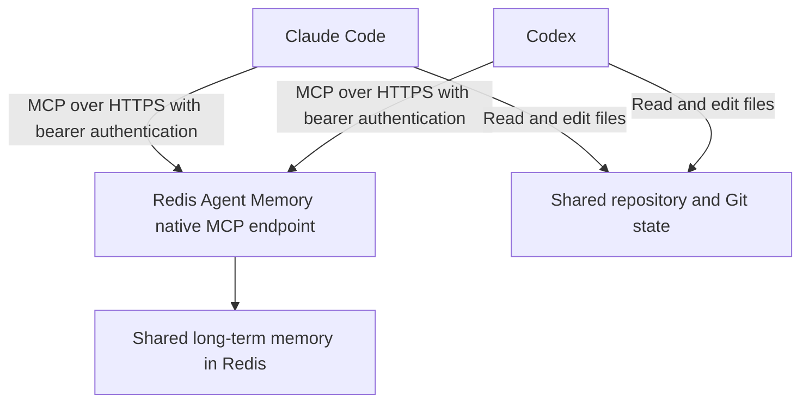
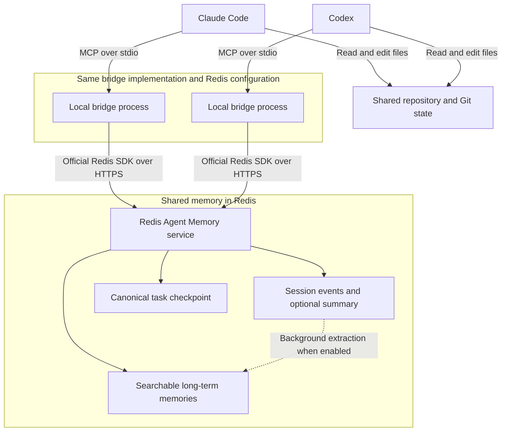

# Redis Agent Memory MCP bridge

Give Claude Desktop and ChatGPT Desktop a durable project memory backed by Redis Agent Memory. The project keeps useful context available across new chats and agent handoffs, without making people repeat the project history every time.

In a local Codex chat inside ChatGPT Desktop, submitted prompts and available final responses are saved automatically and retried after outages. Claude Desktop uses a one-click MCPB extension to search memory, record important work, and save checkpoints. Existing Claude and ChatGPT exports can also be imported into the same Redis memory store.

## When to use it

- Continue a project in a new chat without restating earlier decisions.
- Hand work between Claude Desktop, ChatGPT Desktop, Claude Code, and Codex.
- Recover the latest goal, completed work, blockers, and next steps after a break.
- Search durable decisions across related tasks while keeping projects separated by namespace.
- Seed Redis Agent Memory with existing Claude or ChatGPT conversation exports.

## Choose a quickstart

- [Claude Desktop quickstart](docs/quickstart-claude-desktop.md): build and install the MCPB extension, verify Redis, and optionally import Claude history.
- [ChatGPT Desktop quickstart](docs/quickstart-chatgpt-desktop.md): enable automatic saving in a local Codex project and optionally import ChatGPT history.

## What is automatic

| Client or workflow | Memory behavior | Retry queue |
| --- | --- | --- |
| ChatGPT Desktop, local Codex chat | Prompts and available final responses save automatically after project hooks are trusted | Yes |
| Claude Desktop | Claude chooses when to call the extension's memory and checkpoint tools | No |
| Claude or ChatGPT import | Preview by default; `--write` queues selected historical records | Yes |
| Cloud-orchestrated ChatGPT Work chat | Local project hooks do not run | No |

Automatic saving is enabled by default. It can be disabled explicitly in `.memory-capture.json`. Claude Desktop remains model-directed because ordinary Desktop Chat does not expose the lifecycle hooks needed for passive capture.

## Import existing history

Both importers are dry runs unless `--write` is supplied:

```sh
npm run capture:import:claude -- --input /path/to/claude-export.zip
npm run capture:import:chatgpt -- --input /path/to/chatgpt-export.zip
```

They preserve roles and timestamps, redact known credential patterns, use deterministic record IDs, and support conversation/date filters. See [Import existing memories](docs/importing-memories.md) before writing a large export.

## Redis Agent Memory capabilities

Redis Agent Memory provides:

- Ordered session history for exact conversational context.
- Long-term semantic memory across sessions.
- Automatic summarization and extraction of durable facts.
- Semantic, keyword, and hybrid retrieval with metadata filters.
- Python, TypeScript, and REST APIs.
- Compatibility with any model provider or agent framework.

See the [Redis Agent Memory documentation](https://redis.io/docs/latest/develop/ai/context-engine/agent-memory/) for the service's full capabilities. This bridge currently exposes semantic search through `memory_search`; keyword and hybrid search are not exposed as separate bridge tools. When automatic summarization is enabled, session retrieval can return a summary and recent events rather than every original turn; use `includeSummarisedEvents` when requesting the underlying session history.

## Use cases

The examples below use the optional bridge's tools. For a direct native connection, use the [native handoff workflow](docs/native-tools.md#handoff-using-native-tools).

### Switch agents when credits run out

Start a task in Claude Code and continue in Codex when you reach your Claude usage limit. Both clients connect to this bridge using the same Redis store, owner, namespace, and task session ID. Save checkpoints during the work so the next agent can retrieve the latest saved goal, decisions, completed work, blockers, and next steps with `resume_context`.

Example prompts, using `checkout-retry-123` as the shared session ID:

> **In Claude Code:** Work on checkout retries using memory session `checkout-retry-123`. Record important progress and save a checkpoint after each milestone, including the repository path, branch, changed files, test results, and next steps.

> **In Codex:** Call `resume_context` for session `checkout-retry-123` with query "checkout retries, decisions, tests, blockers, and next steps". Inspect the repository and current Git state, then continue from the latest checkpoint.

Saving regularly matters: if a usage limit interrupts Claude before its next checkpoint, Codex can recover only what was already written to Redis and the shared working tree.

### Resume after a break or a new chat

Return to an unfinished feature or investigation without explaining the whole task again. Use the original session ID to retrieve its checkpoint, ordered conversation events, and any session summary returned by Redis. The next agent can establish what was tried and where to continue.

### Recall decisions across related tasks

Use `memory_search` to recall earlier architectural decisions, project constraints, or durable preferences before starting related work. For example, query "why did we choose exponential backoff for checkout retries?" within the same owner and project namespace. Relevant long-term memories can be retrieved across task sessions after Redis has extracted them.

### Hand off an investigation between agents

Have Claude Code investigate a failing test, record attempted fixes and findings, and save a checkpoint. Codex can retrieve that context and implement the next proposed step. Both agents need access to the relevant repository and files; memory records describe the work but do not transfer files or running processes.

### Keep project context separate

Configure a separate namespace for each project and use a distinct session ID for each task. Semantic recall includes the owner filter and, when configured, the namespace filter. This keeps unrelated project memories out of ordinary searches; these filters organize retrieval and do not replace service authentication or authorization.

## Technical setup and operations

For local Codex automatic capture, the installer creates trusted-project hook configuration, a default-enabled `.memory-capture.json`, a private `.env` template, and a local retry queue:

```sh
git clone https://github.com/alberttwong/redis-agent-memory-mcp.git
cd redis-agent-memory-mcp
npm ci
npm run capture:install
```

Add `AGENT_MEMORY_BASE_URL`, `AGENT_MEMORY_STORE_ID`, and `AGENT_MEMORY_API_KEY` to `.env`, then run `npm run capture:doctor`. Open the repository in a local Codex chat, review and trust the hook with `/hooks`, and start a new session. See [Automatic capture](docs/automatic-capture.md) and [Automatic saving operations](docs/automatic-saving-operations.md) for identity, retries, another-project installation, and removal.

### Claude Desktop packaging

Run `npm run mcpb:test`, then install `build/redis-agent-memory-0.1.0.mcpb` from **Claude Desktop → Settings → Extensions → Advanced settings → Install Extension…**. The CLI installer remains available as a development fallback with `npm run capture:install:claude-desktop`. See [Claude Desktop setup and limitations](docs/claude-desktop.md) for configuration, verification, status, retry, and removal.

### Optional direct native MCP access

Automatic saving does not require agent-facing native MCP access. See [Optional native MCP connector setup](docs/native-mcp-setup.md) when Claude Desktop or Codex should also perform explicit memory searches, writes, or document operations.

## Architecture

The recommended direct connection shares long-term memory through the native endpoint:



The optional bridge adds session history and structured resume tools through the Redis SDK:



Each client launches its own local bridge process. Both processes use the same Redis Agent Memory endpoint and store, with matching owner and namespace settings. A shared task session ID links the work across clients.

`memory_append` writes session events. `checkpoint_save` writes or updates a deterministic long-term memory record for the task. `resume_context` fetches that checkpoint directly, retrieves session history, and searches for relevant long-term memories in parallel.

The MCP bridge records content agents send through its tools. The default-enabled [capture hooks](docs/automatic-capture.md) save submitted prompts and available final responses without tool calls by the model. Neither mechanism detects exhausted credits, switches clients, or transfers hidden reasoning. Share or synchronize the working tree separately.

## Optional bridge tools

- `memory_health` checks the configured Redis Agent Memory store.
- `memory_append` records an ordered user, assistant, or system event.
- `memory_get_session` retrieves the session summary and retained events.
- `memory_search` performs owner- and namespace-scoped semantic recall.
- `checkpoint_save` creates or updates the task's durable handoff record.
- `resume_context` returns the exact checkpoint, current session, and relevant long-term memories together.

## Optional bridge setup

For structured checkpoints and ordered session history, see the separate [optional bridge setup guide](docs/bridge-setup.md). It includes Claude Code, Claude Desktop, Codex, and the bridge handoff workflow.

## Security notes

- For the optional bridge, the store API key stays in `.env` and is never returned by a bridge tool. For native connections, use the client's secret storage or a local untracked configuration.
- The optional bridge filters semantic search by `ownerId` and applies namespace filtering when configured. With native tools, explicitly pass the appropriate `owner_id` and `namespace` filters.
- Redis semantic exclusions are advisory. Do not send secrets or sensitive transient data to session memory.
- The optional bridge exposes no delete tool. The native endpoint does expose `delete_long_term_memories`; use it only for intended memory removals.
