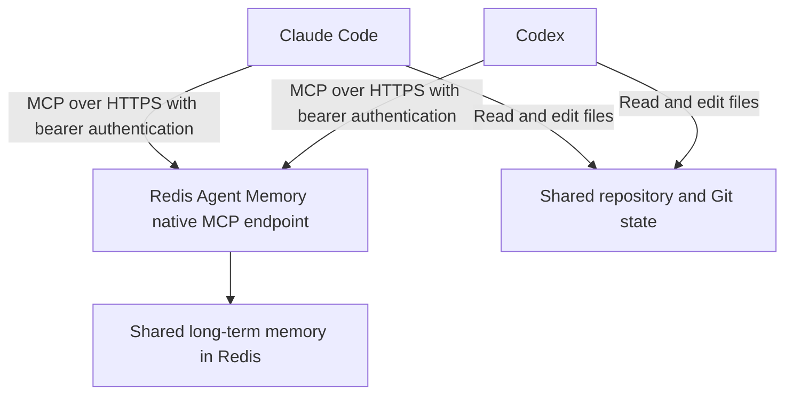
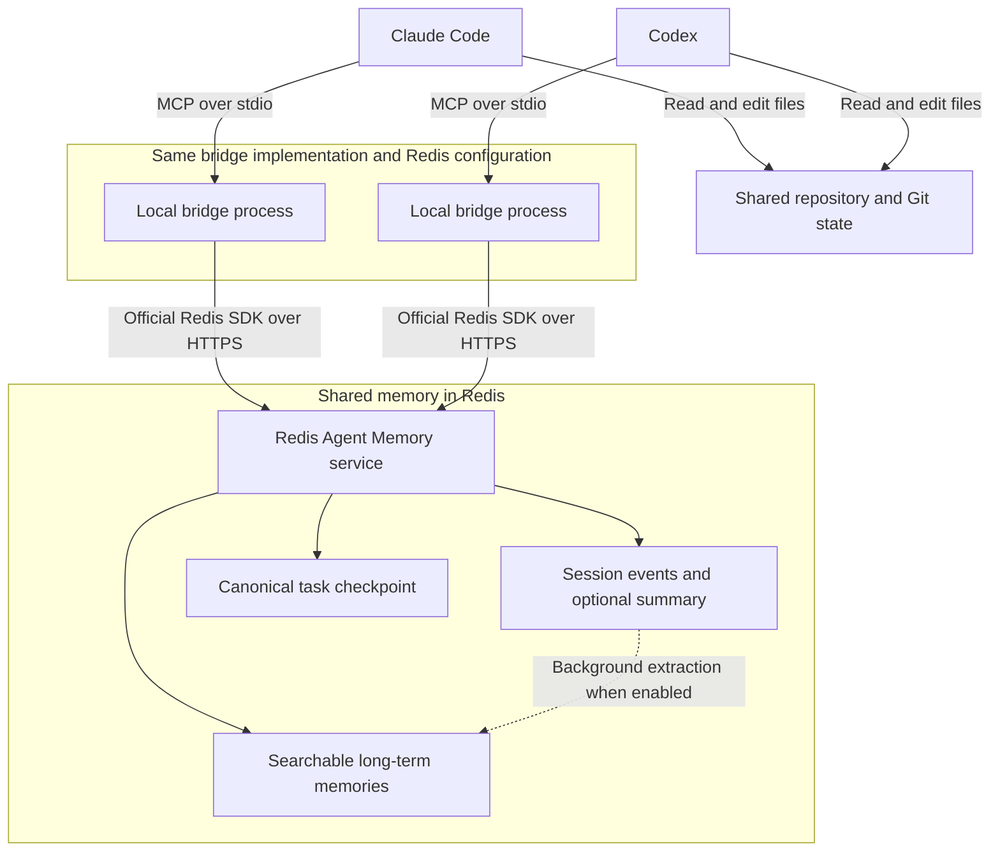

# Redis Agent Memory MCP bridge

Share Redis Agent Memory between Claude Desktop, Claude Code, and Codex using Redis's native MCP endpoint. For standard long-term memory operations, connect directly to Redis without running this project's local server. This repository also includes an optional bridge for ordered session events and structured task checkpoints.

**Using Claude Desktop?** Follow [Claude Desktop: native connector](#claude-desktop-native-connector) below. For the local bridge, see [Claude Desktop: optional local bridge](#claude-desktop-optional-local-bridge).

**Using Codex Desktop?** Follow [Codex Desktop: native MCP](#codex-desktop-native-mcp) below, or the [optional bridge setup](#4-connect-codex).

## Recommended: connect to the native MCP endpoint

Configure both clients to use the same Agent Memory service and store:

```json
{
  "mcpServers": {
    "redis-agent-memory": {
      "url": "<MEMORY_URL>/v1/stores/<MEMORY_STORE_ID>/mcp",
      "headers": {
        "Authorization": "Bearer <MEMORY_KEY>"
      }
    }
  }
}
```

This illustrates the endpoint and authentication; use your client's supported configuration format and secret storage. `<MEMORY_URL>` is the HTTPS service endpoint, `<MEMORY_STORE_ID>` identifies your store, and `<MEMORY_KEY>` is its API key. The placeholder template is also available in `.mcp.native.json.example`. No local Node process or bridge installation is required for a direct connection. Keep populated configuration containing the key outside source control.

### Claude Desktop: native connector

Add the remote connector through Claude's account settings; the generic JSON example above is not a Claude Desktop local-server configuration.

1. Open **Customize → Connectors → + Add → Add custom connector**. On Team/Enterprise, an authorized owner may need to add it under **Organization settings → Connectors** first.
2. Name it `Redis Agent Memory` and enter `<MEMORY_URL>/v1/stores/<MEMORY_STORE_ID>/mcp` as the remote server URL. Click **Continue**.
3. For the Redis API-key endpoint tested here, choose **No sign in** for OAuth authentication. Under **Request headers**, add `Authorization` with value `Bearer <MEMORY_KEY>`. Enter the actual key privately in that field, not in chat or the URL.
4. Click **Add**, then connect if prompted. In a conversation, open **+ → Connectors** and enable Redis Agent Memory.
5. Ask: “Use `search_long_term_memory` with `owner_id` `desktop-test`, `namespace` `desktop-test`, and `limit` 1. Do not create or delete memories.” An empty successful result is sufficient.

Remote connectors run from Anthropic's infrastructure. Our SDK test verified the Redis endpoint, not this Desktop setup end to end. See [Anthropic's remote connector guide](https://support.claude.com/en/articles/11175166-get-started-with-custom-connectors-using-remote-mcp).

### Codex Desktop: native MCP

Codex Desktop shares MCP configuration with the CLI on the same host.

1. Open **Settings → MCP servers → Add server**. Choose **Streamable HTTP**, name it `redis-agent-memory`, and enter `<MEMORY_URL>/v1/stores/<MEMORY_STORE_ID>/mcp`.
2. Configure bearer authentication in your private `~/.codex/config.toml`. Merge this table, replacing any existing table with the same server name rather than duplicating it:

```toml
[mcp_servers.redis-agent-memory]
url = "<MEMORY_URL>/v1/stores/<MEMORY_STORE_ID>/mcp"
http_headers = { Authorization = "Bearer <MEMORY_KEY>" }
```

3. Replace the placeholders privately. This configuration contains a credential; keep it out of Git. Alternatively, replace `http_headers` with `bearer_token_env_var = "AGENT_MEMORY_API_KEY"` and ensure that variable is present in the Desktop app's launch environment. The project's `.env` is not automatically loaded by a native HTTP connection.
4. Save and select **Restart** in MCP settings. Start a fresh chat and use `/mcp` to check connection status.
5. Ask Codex to call `search_long_term_memory` with `owner_id` `desktop-test`, `namespace` `desktop-test`, and `limit` 1, without writing or deleting memories.

These instructions follow the [official OpenAI MCP documentation](https://learn.chatgpt.com/docs/extend/mcp?surface=app). The endpoint was tested with an SDK client; Desktop setup has not been verified end to end.

### Verified native tools

A live test on October 15, 2026 successfully authenticated, initialized an MCP client, discovered nine tools, and executed a read-only `search_long_term_memory` call scoped to a synthetic test owner and namespace. It returned an empty result without errors. No memories were written or deleted during testing.

The tested endpoint exposed:

- `create_long_term_memories`
- `search_long_term_memory`
- `edit_long_term_memory`
- `delete_long_term_memories`
- `create_document_ingestion`
- `get_document_ingestion`
- `list_document_ingestion_outputs`
- `list_memory_sources`
- `list_source_memories`

Session-history, health, and combined resume tools were not present in that endpoint's discovered tool list. Availability can differ by deployment; discover the tools on your own service before relying on them. Write operations, embeddings, and document extraction were not verified by this read-only test.

### Handoff using native tools

In Claude Code, use `create_long_term_memories` to save progress under a stable memory ID such as `checkout-retry-123-handoff`, with the same `owner_id`, `namespace`, and `session_id` throughout the task. Include the current goal, decisions, completed work, next steps, blockers, branch, and test results in the memory text. Use `edit_long_term_memory` to update the existing handoff record as work progresses.

In Codex, use `search_long_term_memory` with the matching `owner_id`, `namespace`, and `session_id` to retrieve the saved handoff. Filter-only searches can use `sort_by: "updatedAt"` and `sort_order: "desc"`. Inspect the shared repository before continuing. Save regularly so a sudden credit limit leaves a recent checkpoint available.

The native tools use snake_case arguments; the optional bridge tools below use camelCase. The snippets in `integration/` are specifically for the bridge and reference its tool names.

## Redis Agent Memory capabilities

Redis Agent Memory provides:

- Ordered session history for exact conversational context.
- Long-term semantic memory across sessions.
- Automatic summarization and extraction of durable facts.
- Semantic, keyword, and hybrid retrieval with metadata filters.
- Python, TypeScript, and REST APIs.
- Compatibility with any model provider or agent framework.

See the [Redis Agent Memory documentation](https://redis.io/docs/latest/develop/ai/context-engine/agent-memory/) for the service's full capabilities. This bridge currently exposes semantic search through `memory_search`; keyword and hybrid search are not exposed as separate bridge tools. When automatic summarization is enabled, session retrieval can return a summary and recent events rather than every original turn; use `includeSummarisedEvents` when requesting the underlying session history.

## Use cases

The examples below use the optional bridge's tools. For a direct native connection, use the native handoff workflow above.

### Switch agents when credits run out

Start a task in Claude Code and continue in Codex when you reach your Claude usage limit. Both clients connect to this bridge using the same Redis store, owner, namespace, and task session ID. Save checkpoints during the work so the next agent can retrieve the latest saved goal, decisions, completed work, blockers, and next steps with `resume_context`.

Example prompts, using `checkout-retry-123` as the shared session ID:

> **In Claude Code:** Work on checkout retries using memory session `checkout-retry-123`. Record important progress and save a checkpoint after each milestone, including the repository path, branch, changed files, test results, and next steps.

> **In Codex:** Call `resume_context` for session `checkout-retry-123` with query "checkout retries, decisions, tests, blockers, and next steps". Inspect the repository and current Git state, then continue from the latest checkpoint.

Saving regularly matters: if a usage limit interrupts Claude before its next checkpoint, Codex can recover only what was already written to Redis and the shared working tree.

### Resume after a break or a new chat

Return to an unfinished feature or investigation without explaining the whole task again. Use the original session ID to retrieve its checkpoint, ordered conversation events, and any session summary returned by Redis. The next agent can establish what was tried and where to continue.

### Recall decisions across related tasks

Use `memory_search` to recall earlier architectural decisions, project constraints, or durable preferences before starting related work. For example, query "why did we choose exponential backoff for checkout retries?" within the same owner and project namespace. Relevant long-term memories can be retrieved across task sessions after Redis has extracted them.

### Hand off an investigation between agents

Have Claude Code investigate a failing test, record attempted fixes and findings, and save a checkpoint. Codex can retrieve that context and implement the next proposed step. Both agents need access to the relevant repository and files; memory records describe the work but do not transfer files or running processes.

### Keep project context separate

Configure a separate namespace for each project and use a distinct session ID for each task. Semantic recall includes the owner filter and, when configured, the namespace filter. This keeps unrelated project memories out of ordinary searches; these filters organize retrieval and do not replace service authentication or authorization.

## Architecture

The recommended direct connection shares long-term memory through the native endpoint:



The optional bridge adds session history and structured resume tools through the Redis SDK:



Each client launches its own local bridge process. Both processes use the same Redis Agent Memory endpoint and store, with matching owner and namespace settings. A shared task session ID links the work across clients.

`memory_append` writes session events. `checkpoint_save` writes or updates a deterministic long-term memory record for the task. `resume_context` fetches that checkpoint directly, retrieves session history, and searches for relevant long-term memories in parallel.

The bridge records only the content agents explicitly send through its tools. It does not automatically capture every chat turn, detect exhausted credits, switch clients, or transfer a model's hidden reasoning. Use the included agent instruction snippets to establish a regular save-and-resume workflow, and share or synchronize the working tree separately.

## Optional bridge tools

- `memory_health` checks the configured Redis Agent Memory store.
- `memory_append` records an ordered user, assistant, or system event.
- `memory_get_session` retrieves the session summary and retained events.
- `memory_search` performs owner- and namespace-scoped semantic recall.
- `checkpoint_save` creates or updates the task's durable handoff record.
- `resume_context` returns the exact checkpoint, current session, and relevant long-term memories together.

## Optional bridge setup

The following steps install the local bridge. Skip them when using the native endpoint directly.

### 1. Configure Redis Agent Memory

Clone the repository (requires access while the repository is private):

```sh
git clone https://github.com/alberttwong/redis-agent-memory-mcp.git
cd redis-agent-memory-mcp
```

Create an Agent Memory service in Redis Cloud and copy `.env.example` to `.env`:

```sh
cp .env.example .env
```

Fill in:

```dotenv
AGENT_MEMORY_BASE_URL=https://your-agent-memory-endpoint
AGENT_MEMORY_STORE_ID=your-store-id
AGENT_MEMORY_API_KEY=your-store-api-key
AGENT_MEMORY_OWNER_ID=albert
AGENT_MEMORY_NAMESPACE_ID=your-namespace-resource-id
AGENT_MEMORY_AGENT_ID=shared-agent
```

`AGENT_MEMORY_NAMESPACE_ID` is preferred. For an older store without namespace resources, set `AGENT_MEMORY_NAMESPACE=project-memory` instead. Never commit `.env`.

### 2. Build and verify

```sh
npm install
npm test
```

The launch script loads `.env`, finds Node through NVM when necessary, builds on first run, and starts the stdio MCP server:

```sh
./scripts/start.sh
```

### 3. Connect Claude Code

Copy `.mcp.json.example` to `.mcp.json` in the project Claude will work in. Update the absolute path if this bridge moves:

```sh
cp .mcp.json.example .mcp.json
```

Copy the guidance in `integration/CLAUDE.md.snippet` into that project's `CLAUDE.md`. Start a fresh Claude Code session after changing MCP configuration.

### Claude Desktop: optional local bridge

After completing bridge setup steps 1–2, configure Claude Desktop to launch it on macOS:

1. Open **Claude → Settings → Developer → Edit Config**. The file is `~/Library/Application Support/Claude/claude_desktop_config.json`.
2. Merge this entry into the existing `mcpServers` object, preserving other servers:

```json
{
  "mcpServers": {
    "redis-agent-memory-bridge": {
      "command": "/bin/zsh",
      "args": ["/absolute/path/to/redis-agent-memory-mcp/scripts/start.sh"]
    }
  }
}
```

3. Replace the path with the actual clone location. The launcher reads that clone's `.env`; do not put the key in the JSON.
4. Fully quit and reopen Claude Desktop. Enable the bridge in the conversation's connector menu and ask it to call `memory_health`.

Claude Desktop does not load the project's `.mcp.json` or `CLAUDE.md` as Claude Code does. Provide the save/resume guidance from `integration/CLAUDE.md.snippet` in your Desktop conversation or project instructions. The supplied launcher uses zsh and is intended for macOS; this is not a Windows launcher.

For connection failures, inspect `~/Library/Logs/Claude/`. See the [official local MCP setup guide](https://modelcontextprotocol.io/docs/develop/connect-local-servers).

### 4. Connect Codex

Register the same stdio server:

```sh
codex mcp add redis-agent-memory -- zsh /absolute/path/to/redis-agent-memory-mcp/scripts/start.sh
codex mcp list
```

Copy `integration/AGENTS.md.snippet` into the target project's `AGENTS.md`. Start a fresh Codex session so it discovers the new tools.

## Suggested handoff flow

Use a stable session ID such as `project-feature-123` in both agents.

1. Claude calls `memory_append` for important turns while working.
2. Claude calls `checkpoint_save` before the switch.
3. Codex calls `resume_context` using the same session ID.
4. Codex verifies the repository and Git state, continues the work, appends important turns, and updates the same checkpoint.

Long-term extraction is asynchronous. `resume_context` does not rely only on extraction: it fetches the deterministic checkpoint directly, then adds current session history and semantic recall.

## Security notes

- For the optional bridge, the store API key stays in `.env` and is never returned by a bridge tool. For native connections, use the client's secret storage or a local untracked configuration.
- The optional bridge filters semantic search by `ownerId` and applies namespace filtering when configured. With native tools, explicitly pass the appropriate `owner_id` and `namespace` filters.
- Redis semantic exclusions are advisory. Do not send secrets or sensitive transient data to session memory.
- The optional bridge exposes no delete tool. The native endpoint does expose `delete_long_term_memories`; use it only for intended memory removals.
