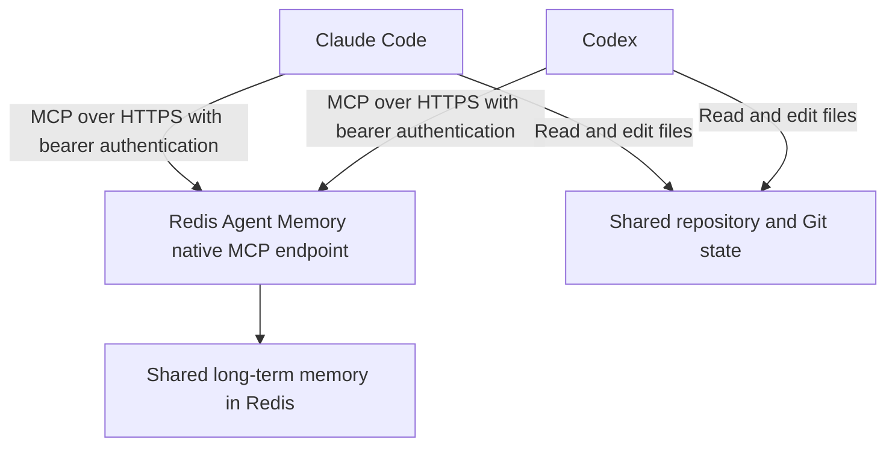
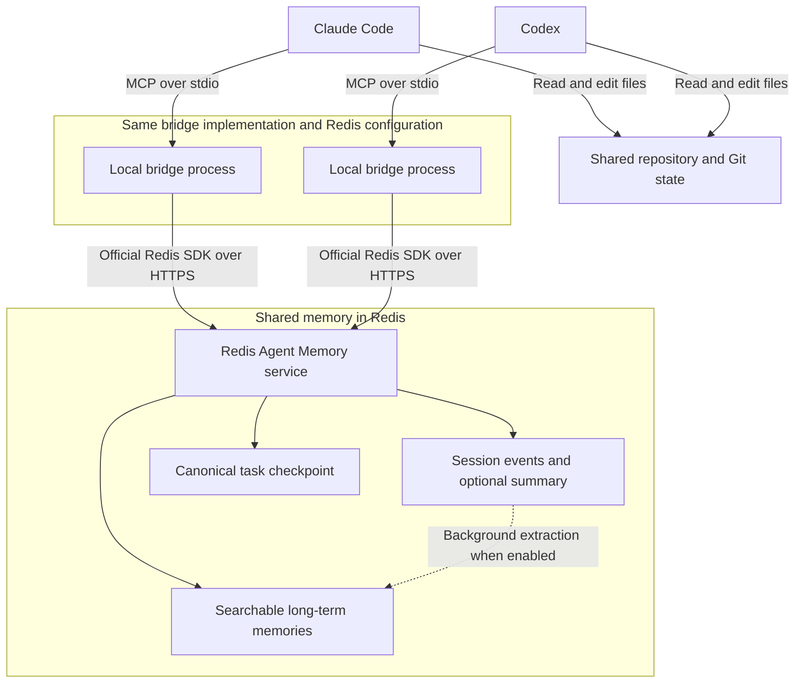

# Redis Agent Memory MCP bridge

Automatic memory saving is the default operating mode for configured Codex projects. Every submitted prompt and available final response is written to a private local retry queue before delivery to Redis Agent Memory. New sessions automatically recall recent context for the same user and project. Agents do not need to call a memory tool or ask the user for owner, namespace, session, or memory IDs on each turn.

The project can also expose native Redis MCP tools for explicit searches and writes, and includes an optional local bridge for ordered session events and structured task checkpoints. Ordinary Claude Desktop chat does not run local Codex or Claude Code hooks.

## Quick start

Install the project-scoped hooks and default-enabled capture configuration:

```sh
git clone https://github.com/alberttwong/redis-agent-memory-mcp.git
cd redis-agent-memory-mcp
npm ci
npm run capture:install
```

The installer preserves existing hooks and configuration. It creates a private `.env` only when one does not exist, enables capture in `.memory-capture.json`, and ignores the local retry queue. Add the Redis values to `.env`:

```dotenv
AGENT_MEMORY_BASE_URL=https://your-agent-memory-endpoint
AGENT_MEMORY_STORE_ID=your-store-id
AGENT_MEMORY_API_KEY=your-store-api-key
```

Confirm the local setup without contacting Redis:

```sh
npm run capture:doctor
```

Open the repository in Codex and review/trust the hook definition when prompted. Codex requires that security review and normal installers cannot approve it silently. After trust is granted, saving and startup recall happen automatically on ordinary turns. Set `enabled` to `false` in `.memory-capture.json` to opt out.

For another repository, run `ram-capture install --project /absolute/path/to/project`; see the [automatic capture guide](docs/automatic-capture.md) for installation, identity, retry, and uninstall details.

## Optional direct native MCP access

Automatic saving does not require the agent-facing native MCP connection below; the capture handler talks to the same endpoint itself. Configure the connector when agents should also perform explicit memory searches, writes, or document operations.

Configure both clients to use the same Agent Memory service and store:

```json
{
  "mcpServers": {
    "redis-agent-memory": {
      "url": "<MEMORY_URL>/v1/stores/<MEMORY_STORE_ID>/mcp",
      "headers": {
        "Authorization": "Bearer <MEMORY_KEY>"
      }
    }
  }
}
```

This illustrates the endpoint and authentication; use your client's supported configuration format and secret storage. `<MEMORY_URL>` is the HTTPS service endpoint, `<MEMORY_STORE_ID>` identifies your store, and `<MEMORY_KEY>` is its API key. The placeholder template is also available in `.mcp.native.json.example`. No local Node process or bridge installation is required for a direct connection. Keep populated configuration containing the key outside source control.

### Claude Desktop: native connector

Add the remote connector through Claude's account settings; the generic JSON example above is not a Claude Desktop local-server configuration.

1. Open **Customize → Connectors → + Add → Add custom connector**. On Team/Enterprise, an authorized owner may need to add it under **Organization settings → Connectors** first.
2. Name it `Redis Agent Memory` and enter `<MEMORY_URL>/v1/stores/<MEMORY_STORE_ID>/mcp` as the remote server URL. Click **Continue**.
3. For the Redis API-key endpoint tested here, choose **No sign in** for OAuth authentication. Under **Request headers**, add `Authorization` with value `Bearer <MEMORY_KEY>`. Enter the actual key privately in that field, not in chat or the URL.
4. Click **Add**, then connect if prompted. In a conversation, open **+ → Connectors** and enable Redis Agent Memory.
5. Ask: “Use `search_long_term_memory` with `owner_id` `desktop-test`, `namespace` `desktop-test`, and `limit` 1. Do not create or delete memories.” An empty successful result is sufficient.

Remote connectors run from Anthropic's infrastructure. Our SDK test verified the Redis endpoint, not this Desktop setup end to end. See [Anthropic's remote connector guide](https://support.claude.com/en/articles/11175166-get-started-with-custom-connectors-using-remote-mcp).

### Codex Desktop: native MCP

Codex Desktop shares MCP configuration with the CLI on the same host.

This section adds agent-callable memory tools. Automatic saving remains active independently through the project hooks.

Use the configuration-file route below; it does not depend on a Desktop settings menu being available.

1. Open your private `~/.codex/config.toml` in a text editor (create the file if needed).
2. Merge this table, replacing any existing table with the same server name rather than duplicating it. Preserve unrelated configuration:

```toml
[mcp_servers.redis-agent-memory]
url = "<MEMORY_URL>/v1/stores/<MEMORY_STORE_ID>/mcp"
http_headers = { Authorization = "Bearer <MEMORY_KEY>" }
```

3. Replace the placeholders privately. This configuration contains a credential; keep it out of Git. Alternatively, replace `http_headers` with `bearer_token_env_var = "AGENT_MEMORY_API_KEY"` and ensure that variable is present in the Desktop app's launch environment. The project's `.env` is not automatically loaded by a native HTTP connection.
4. Save the file, fully quit and reopen Codex Desktop, and start a fresh local chat. If the Codex CLI is installed, run `codex mcp list` to confirm the server is configured; listing alone does not verify live connectivity.
5. Ask Codex to call `search_long_term_memory` with `owner_id` `desktop-test`, `namespace` `desktop-test`, and `limit` 1, without writing or deleting memories.

For an environment-based configuration, the CLI can also register the server with `codex mcp add redis-agent-memory --url "<MEMORY_URL>/v1/stores/<MEMORY_STORE_ID>/mcp" --bearer-token-env-var AGENT_MEMORY_API_KEY`. The Desktop process must still receive that environment variable.

See the [official OpenAI MCP configuration documentation](https://learn.chatgpt.com/docs/extend/mcp?surface=app#configure-with-configtoml). The endpoint was tested with an SDK client; Desktop setup has not been verified end to end.

### Automatic saving operations

The capture handler runs locally with Node.js 20.12+ and is enabled by default by `ram-capture install`. It connects to Redis's native MCP endpoint directly; registering the optional stdio bridge is not required.

The owner defaults to a hash of the OS account and hostname, the namespace defaults to the project name, sessions derive from each client conversation, and memory IDs are generated automatically. Set `AGENT_MEMORY_OWNER_ID` in the private `.env` only when the same identity must be shared across computers.

Check delivery or retry pending writes at any time:

```sh
npm run capture:status
# Retry delivery if pending is greater than zero:
npm run capture:flush
```

The status command reports the resolved owner, namespace, and pending queue count. Use those values to inspect Redis records with the `auto-capture` topic, or ask the agent: “Retrieve my recent project memories using the scope supplied by the capture hook.” A zero pending count only describes the queue; verify a saved record to confirm that the client actually invoked a hook.

The package also includes a Codex plugin manifest and bundled hooks. Plugin distributors can ship the package after `npm pack`; the hooks resolve the handler through `$PLUGIN_ROOT`. Codex still requires users to review and trust plugin hooks. Run `ram-capture uninstall` (or `npm run capture:uninstall`) to remove only installer-managed project hooks; local configuration, credentials, and queued data are deliberately preserved.

Capture is project-scoped. Opening another project does not install hooks there. To record work in your own application repository, follow [Use another project](docs/automatic-capture.md#use-another-project), which covers merging hooks, using the installed handler's absolute path, and configuring a separate project namespace. See the [full capture guide](docs/automatic-capture.md) for retry behavior, identity overrides, and supported events.

The handler has been tested live for prompt delivery, final-response capture, retry, and cross-client recall using hook payloads. Records use long-term-memory type `message`, not Redis's ordered session-memory API.

The verified native-tool inventory and direct cross-agent workflow now live in [Native Redis Agent Memory tools](docs/native-tools.md).

## Redis Agent Memory capabilities

Redis Agent Memory provides:

- Ordered session history for exact conversational context.
- Long-term semantic memory across sessions.
- Automatic summarization and extraction of durable facts.
- Semantic, keyword, and hybrid retrieval with metadata filters.
- Python, TypeScript, and REST APIs.
- Compatibility with any model provider or agent framework.

See the [Redis Agent Memory documentation](https://redis.io/docs/latest/develop/ai/context-engine/agent-memory/) for the service's full capabilities. This bridge currently exposes semantic search through `memory_search`; keyword and hybrid search are not exposed as separate bridge tools. When automatic summarization is enabled, session retrieval can return a summary and recent events rather than every original turn; use `includeSummarisedEvents` when requesting the underlying session history.

## Use cases

The examples below use the optional bridge's tools. For a direct native connection, use the [native handoff workflow](docs/native-tools.md#handoff-using-native-tools).

### Switch agents when credits run out

Start a task in Claude Code and continue in Codex when you reach your Claude usage limit. Both clients connect to this bridge using the same Redis store, owner, namespace, and task session ID. Save checkpoints during the work so the next agent can retrieve the latest saved goal, decisions, completed work, blockers, and next steps with `resume_context`.

Example prompts, using `checkout-retry-123` as the shared session ID:

> **In Claude Code:** Work on checkout retries using memory session `checkout-retry-123`. Record important progress and save a checkpoint after each milestone, including the repository path, branch, changed files, test results, and next steps.

> **In Codex:** Call `resume_context` for session `checkout-retry-123` with query "checkout retries, decisions, tests, blockers, and next steps". Inspect the repository and current Git state, then continue from the latest checkpoint.

Saving regularly matters: if a usage limit interrupts Claude before its next checkpoint, Codex can recover only what was already written to Redis and the shared working tree.

### Resume after a break or a new chat

Return to an unfinished feature or investigation without explaining the whole task again. Use the original session ID to retrieve its checkpoint, ordered conversation events, and any session summary returned by Redis. The next agent can establish what was tried and where to continue.

### Recall decisions across related tasks

Use `memory_search` to recall earlier architectural decisions, project constraints, or durable preferences before starting related work. For example, query "why did we choose exponential backoff for checkout retries?" within the same owner and project namespace. Relevant long-term memories can be retrieved across task sessions after Redis has extracted them.

### Hand off an investigation between agents

Have Claude Code investigate a failing test, record attempted fixes and findings, and save a checkpoint. Codex can retrieve that context and implement the next proposed step. Both agents need access to the relevant repository and files; memory records describe the work but do not transfer files or running processes.

### Keep project context separate

Configure a separate namespace for each project and use a distinct session ID for each task. Semantic recall includes the owner filter and, when configured, the namespace filter. This keeps unrelated project memories out of ordinary searches; these filters organize retrieval and do not replace service authentication or authorization.

## Architecture

The recommended direct connection shares long-term memory through the native endpoint:



The optional bridge adds session history and structured resume tools through the Redis SDK:



Each client launches its own local bridge process. Both processes use the same Redis Agent Memory endpoint and store, with matching owner and namespace settings. A shared task session ID links the work across clients.

`memory_append` writes session events. `checkpoint_save` writes or updates a deterministic long-term memory record for the task. `resume_context` fetches that checkpoint directly, retrieves session history, and searches for relevant long-term memories in parallel.

The MCP bridge records content agents send through its tools. The default-enabled [capture hooks](docs/automatic-capture.md) save submitted prompts and available final responses without tool calls by the model. Neither mechanism detects exhausted credits, switches clients, or transfers hidden reasoning. Share or synchronize the working tree separately.

## Optional bridge tools

- `memory_health` checks the configured Redis Agent Memory store.
- `memory_append` records an ordered user, assistant, or system event.
- `memory_get_session` retrieves the session summary and retained events.
- `memory_search` performs owner- and namespace-scoped semantic recall.
- `checkpoint_save` creates or updates the task's durable handoff record.
- `resume_context` returns the exact checkpoint, current session, and relevant long-term memories together.

## Optional bridge setup

For structured checkpoints and ordered session history, see the separate [optional bridge setup guide](docs/bridge-setup.md). It includes Claude Code, Claude Desktop, Codex, and the bridge handoff workflow.

## Security notes

- For the optional bridge, the store API key stays in `.env` and is never returned by a bridge tool. For native connections, use the client's secret storage or a local untracked configuration.
- The optional bridge filters semantic search by `ownerId` and applies namespace filtering when configured. With native tools, explicitly pass the appropriate `owner_id` and `namespace` filters.
- Redis semantic exclusions are advisory. Do not send secrets or sensitive transient data to session memory.
- The optional bridge exposes no delete tool. The native endpoint does expose `delete_long_term_memories`; use it only for intended memory removals.
