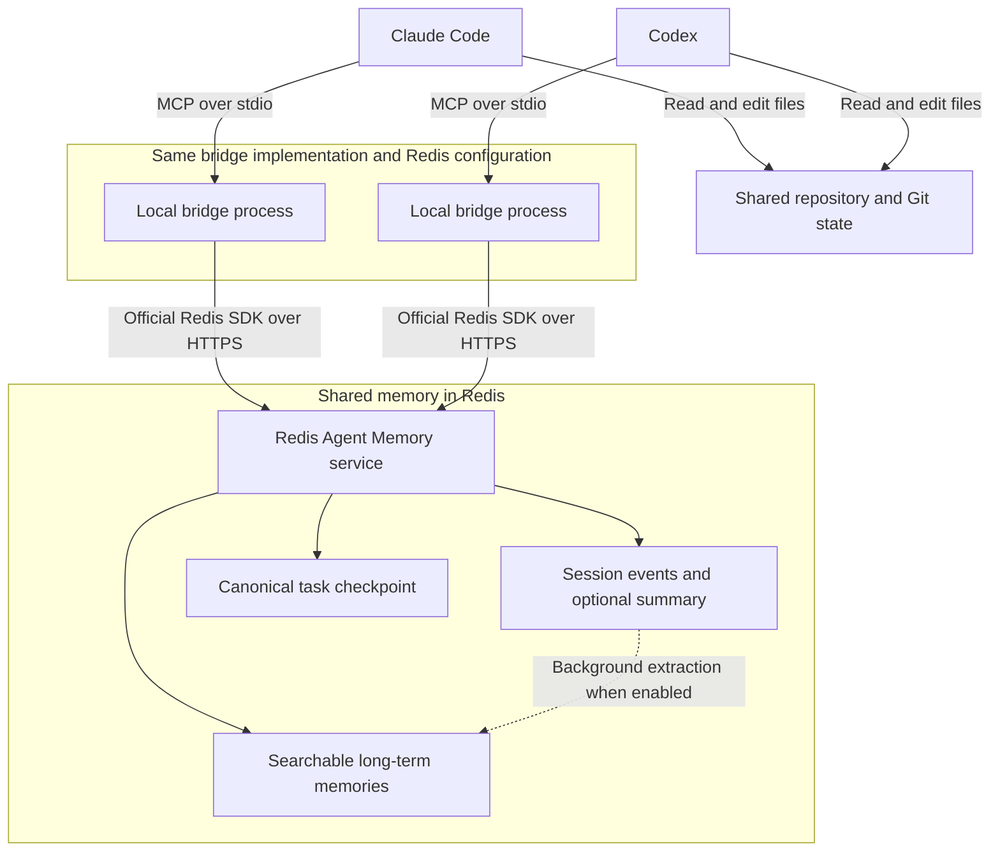

# Redis Agent Memory MCP bridge

This local MCP server gives Claude Code and Codex the same Redis Agent Memory store. It keeps ordered session events, searches durable memory, and maintains one canonical checkpoint per task session.

## Redis Agent Memory capabilities

Redis Agent Memory provides:

- Ordered session history for exact conversational context.
- Long-term semantic memory across sessions.
- Automatic summarization and extraction of durable facts.
- Semantic, keyword, and hybrid retrieval with metadata filters.
- Python, TypeScript, and REST APIs.
- Compatibility with any model provider or agent framework.

See the [Redis Agent Memory documentation](https://redis.io/docs/latest/develop/ai/context-engine/agent-memory/) for the service's full capabilities. This bridge currently exposes semantic search through `memory_search`; keyword and hybrid search are not exposed as separate bridge tools. When automatic summarization is enabled, session retrieval can return a summary and recent events rather than every original turn; use `includeSummarisedEvents` when requesting the underlying session history.

## Use cases

### Switch agents when credits run out

Start a task in Claude Code and continue in Codex when you reach your Claude usage limit. Both clients connect to this bridge using the same Redis store, owner, namespace, and task session ID. Save checkpoints during the work so the next agent can retrieve the latest saved goal, decisions, completed work, blockers, and next steps with `resume_context`.

Example prompts, using `checkout-retry-123` as the shared session ID:

> **In Claude Code:** Work on checkout retries using memory session `checkout-retry-123`. Record important progress and save a checkpoint after each milestone, including the repository path, branch, changed files, test results, and next steps.

> **In Codex:** Call `resume_context` for session `checkout-retry-123` with query "checkout retries, decisions, tests, blockers, and next steps". Inspect the repository and current Git state, then continue from the latest checkpoint.

Saving regularly matters: if a usage limit interrupts Claude before its next checkpoint, Codex can recover only what was already written to Redis and the shared working tree.

### Resume after a break or a new chat

Return to an unfinished feature or investigation without explaining the whole task again. Use the original session ID to retrieve its checkpoint, ordered conversation events, and any session summary returned by Redis. The next agent can establish what was tried and where to continue.

### Recall decisions across related tasks

Use `memory_search` to recall earlier architectural decisions, project constraints, or durable preferences before starting related work. For example, query "why did we choose exponential backoff for checkout retries?" within the same owner and project namespace. Relevant long-term memories can be retrieved across task sessions after Redis has extracted them.

### Hand off an investigation between agents

Have Claude Code investigate a failing test, record attempted fixes and findings, and save a checkpoint. Codex can retrieve that context and implement the next proposed step. Both agents need access to the relevant repository and files; memory records describe the work but do not transfer files or running processes.

### Keep project context separate

Configure a separate namespace for each project and use a distinct session ID for each task. Semantic recall includes the owner filter and, when configured, the namespace filter. This keeps unrelated project memories out of ordinary searches; these filters organize retrieval and do not replace service authentication or authorization.

## Architecture



Each client launches its own local bridge process. Both processes use the same Redis Agent Memory endpoint and store, with matching owner and namespace settings. A shared task session ID links the work across clients.

`memory_append` writes session events. `checkpoint_save` writes or updates a deterministic long-term memory record for the task. `resume_context` fetches that checkpoint directly, retrieves session history, and searches for relevant long-term memories in parallel.

The bridge records only the content agents explicitly send through its tools. It does not automatically capture every chat turn, detect exhausted credits, switch clients, or transfer a model's hidden reasoning. Use the included agent instruction snippets to establish a regular save-and-resume workflow, and share or synchronize the working tree separately.

## Tools

- `memory_health` checks the configured Redis Agent Memory store.
- `memory_append` records an ordered user, assistant, or system event.
- `memory_get_session` retrieves the session summary and retained events.
- `memory_search` performs owner- and namespace-scoped semantic recall.
- `checkpoint_save` creates or updates the task's durable handoff record.
- `resume_context` returns the exact checkpoint, current session, and relevant long-term memories together.

## 1. Configure Redis Agent Memory

Clone the repository (requires access while the repository is private):

```sh
git clone https://github.com/alberttwong/redis-agent-memory-mcp.git
cd redis-agent-memory-mcp
```

Create an Agent Memory service in Redis Cloud and copy `.env.example` to `.env`:

```sh
cp .env.example .env
```

Fill in:

```dotenv
AGENT_MEMORY_BASE_URL=https://your-agent-memory-endpoint
AGENT_MEMORY_STORE_ID=your-store-id
AGENT_MEMORY_API_KEY=your-store-api-key
AGENT_MEMORY_OWNER_ID=albert
AGENT_MEMORY_NAMESPACE_ID=your-namespace-resource-id
AGENT_MEMORY_AGENT_ID=shared-agent
```

`AGENT_MEMORY_NAMESPACE_ID` is preferred. For an older store without namespace resources, set `AGENT_MEMORY_NAMESPACE=project-memory` instead. Never commit `.env`.

## 2. Build and verify

```sh
npm install
npm test
```

The launch script loads `.env`, finds Node through NVM when necessary, builds on first run, and starts the stdio MCP server:

```sh
./scripts/start.sh
```

## 3. Connect Claude Code

Copy `.mcp.json.example` to `.mcp.json` in the project Claude will work in. Update the absolute path if this bridge moves:

```sh
cp .mcp.json.example .mcp.json
```

Copy the guidance in `integration/CLAUDE.md.snippet` into that project's `CLAUDE.md`. Start a fresh Claude Code session after changing MCP configuration.

## 4. Connect Codex

Register the same stdio server:

```sh
codex mcp add redis-agent-memory -- zsh /absolute/path/to/redis-agent-memory-mcp/scripts/start.sh
codex mcp list
```

Copy `integration/AGENTS.md.snippet` into the target project's `AGENTS.md`. Start a fresh Codex session so it discovers the new tools.

## Suggested handoff flow

Use a stable session ID such as `project-feature-123` in both agents.

1. Claude calls `memory_append` for important turns while working.
2. Claude calls `checkpoint_save` before the switch.
3. Codex calls `resume_context` using the same session ID.
4. Codex verifies the repository and Git state, continues the work, appends important turns, and updates the same checkpoint.

Long-term extraction is asynchronous. `resume_context` does not rely only on extraction: it fetches the deterministic checkpoint directly, then adds current session history and semantic recall.

## Security notes

- The store API key stays in `.env` and is never returned by an MCP tool.
- Every semantic search is filtered by `ownerId`; namespace filtering is applied when configured.
- Redis semantic exclusions are advisory. Do not send secrets or sensitive transient data to session memory.
- The MCP server performs no deletes. Deletion and export workflows should be added only with an explicit retention policy.
