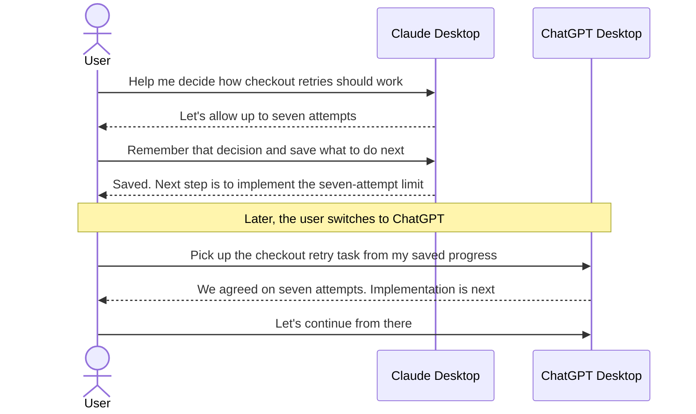

# Redis Agent Memory MCP bridge

Give Claude Desktop and ChatGPT Desktop a durable project memory backed by Redis Agent Memory. The project keeps useful context available across new chats and agent handoffs, without making people repeat the project history every time.

In a local Codex chat inside ChatGPT Desktop, submitted prompts and available final responses are saved automatically and retried after outages. For Claude Desktop, start with **Add marketplace** and configure memory using the browser setup form in a local Claude Code session. Ordinary Desktop Chat uses the MCPB extension. Both provide tools to search memory, record important work, and save checkpoints. Existing Claude and ChatGPT exports can also be imported into the same Redis memory store.

## When to use it

- Continue a project in a new chat without restating earlier decisions.
- Hand work between Claude Desktop, ChatGPT Desktop, Claude Code, and Codex.
- Recover the latest goal, completed work, blockers, and next steps after a break.
- Search durable decisions across related tasks while keeping projects separated by namespace.
- Seed Redis Agent Memory with existing Claude or ChatGPT conversation exports.

## Choose a quickstart

- [Claude Desktop quickstart](docs/quickstart-claude-desktop.md): use **Add marketplace** (default), then the browser setup form in a local Claude Code session. For Desktop Chat, use the MCPB extension.
- [ChatGPT Desktop quickstart](docs/quickstart-chatgpt-desktop.md): add the repository marketplace, install the local plugin, and enable automatic saving.
- [Manual quickstart](docs/technical-setup-and-operations.md): build and cli install and use the optional native or local bridge tools.

Claude Desktop currently uses the plugin's browser form for Redis credentials because native marketplace configuration has an [upstream issue](https://github.com/anthropics/claude-code/issues/95683). Follow the quickstart's setup steps. [Project issue #31](https://github.com/alberttwong/redis-agent-memory-mcp/issues/31) tracks returning to native configuration after a Desktop fix is verified.

## What is automatic

| Client or workflow | Memory behavior | Retry queue |
| --- | --- | --- |
| ChatGPT Desktop, local Codex chat | Prompts and available final responses save automatically after project hooks are trusted | Yes |
| Claude Desktop | Claude chooses when to call the extension's memory and checkpoint tools | No |
| Claude or ChatGPT import | Preview by default; `--write` queues selected historical records | Yes |
| Cloud-orchestrated ChatGPT Work chat | Local project hooks do not run | No |

Automatic saving is enabled by default. It can be disabled explicitly in `.memory-capture.json`. Claude Desktop remains model-directed because ordinary Desktop Chat does not expose the lifecycle hooks needed for passive capture.

To reuse Redis credentials across worktrees and separate checkouts, configure [shared settings outside Git](docs/automatic-saving-operations.md#reuse-redis-settings-across-worktrees-and-checkouts). Each project can override them in its own `.env`.

## Import existing history

Both importers are dry runs unless `--write` is supplied:

```sh
npm run capture:import:claude -- --input /path/to/claude-export.zip
npm run capture:import:chatgpt -- --input /path/to/chatgpt-export.zip
```

They preserve roles and timestamps, redact known credential patterns, use deterministic record IDs, and support conversation/date filters. See [Import existing memories](docs/importing-memories.md) before writing a large export.

## Redis Agent Memory capabilities

Redis Agent Memory provides:

- Ordered session history for exact conversational context.
- Long-term semantic memory across sessions.
- Automatic summarization and extraction of durable facts.
- Semantic, keyword, and hybrid retrieval with metadata filters.
- Python, TypeScript, and REST APIs.
- Compatibility with any model provider or agent framework.

See the [Redis Agent Memory documentation](https://redis.io/docs/latest/develop/ai/context-engine/agent-memory/) for the service's full capabilities. This bridge currently exposes semantic search through `memory_search`; keyword and hybrid search are not exposed as separate bridge tools. When automatic summarization is enabled, session retrieval can return a summary and recent events rather than every original turn; use `includeSummarisedEvents` when requesting the underlying session history.

## Use cases

Once you have connected your apps to the same project memory using the [quickstarts](#choose-a-quickstart), ask your assistant to remember progress and pick it up later. Here are some everyday examples.

### Continue in ChatGPT after starting in Claude

You work with Claude on checkout retries and agree to allow seven attempts. Before leaving, you ask:

> Remember that we agreed on seven attempts. Save where we left off and what to do next.

Later, you open ChatGPT and ask:

> Pick up the checkout retry task from my saved progress. What did we decide, and what's next?

ChatGPT recalls the decision and explains that implementing the seven-attempt limit is next. You can keep working without retelling the earlier discussion.



### Keep going when you reach a usage limit

You are partway through a task in Claude when you reach your usage limit. Open your other connected assistant and ask:

> Continue the checkout retry task from the latest saved progress. Tell me where we left off before making changes.

The assistant uses your saved progress to help you continue. Ask it to save progress at milestones so an unexpected interruption leaves a recent stopping point.

### Return after a break or start a fresh chat

You come back to an unfinished task the next morning, or start a new chat when the old one gets long.

> Pick up the checkout retry task. Remind me what we've finished and what still needs doing.

Your assistant recalls the saved progress, gives you a recap, and helps you choose the next step.

### Remember why you made a decision

You are working on a related feature and want to understand an earlier choice.

> What do you remember about why we chose seven checkout retry attempts?

Your assistant searches your saved project memories so you can revisit the reasoning without digging through old chats.

### Hand over an investigation

You ask Claude to investigate a failing test. Before switching assistants, ask:

> Save what you've tried, what you found, and the next thing we should check.

Then ask ChatGPT:

> Continue the failing-test investigation from the saved findings.

ChatGPT can build on the recorded findings. Make the relevant project files available in both apps so it can continue the work.

### Keep different projects organized

You work on several projects and want each assistant to recall the right background. Set up separate project memories, then name the project when asking to continue:

> In the checkout project, remind me what we decided about retries.

Your assistant can focus on that project's saved decisions and progress.

These examples rely on progress that has been saved. You choose when to switch apps, and each app needs access to the project files you want to work on.

For connection settings and tool-level examples, see the [technical handoff guide](docs/handoff-workflow.md).

## Architecture

Claude and ChatGPT share saved project context through Redis Agent Memory. See the [architecture diagrams and implementation details](docs/handoff-workflow.md#architecture).

## Test the Claude-to-ChatGPT handoff

The end-to-end test checks that progress saved through the Claude package can be retrieved through the ChatGPT package. See [test setup, commands, and coverage](docs/handoff-workflow.md#test-the-claude-to-chatgpt-handoff).

## Security notes

- For the optional bridge, the store API key stays in `.env` and is never returned by a bridge tool. For native connections, use the client's secret storage or a local untracked configuration.
- The optional bridge filters semantic search by `ownerId` and applies namespace filtering when configured. With native tools, explicitly pass the appropriate `owner_id` and `namespace` filters.
- Redis semantic exclusions are advisory. Do not send secrets or sensitive transient data to session memory.
- The optional bridge exposes no delete tool. The native endpoint does expose `delete_long_term_memories`; use it only for intended memory removals.
