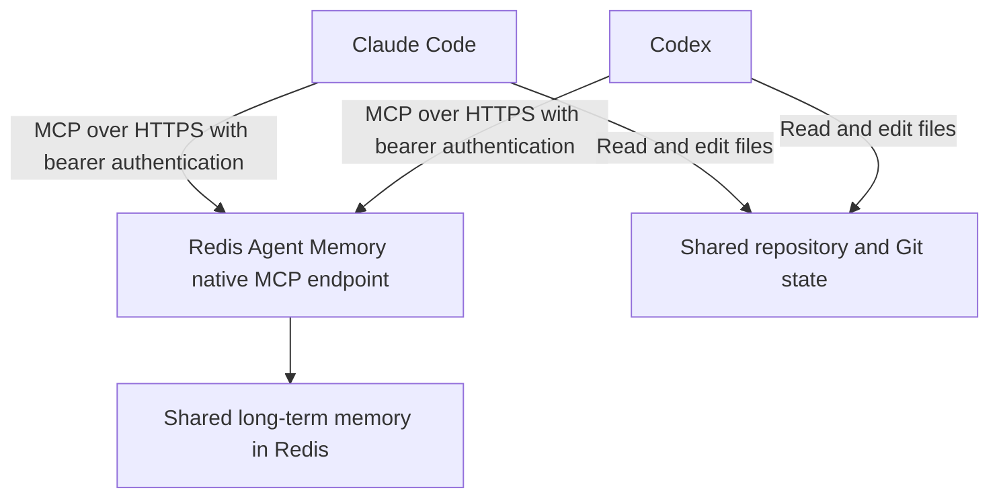
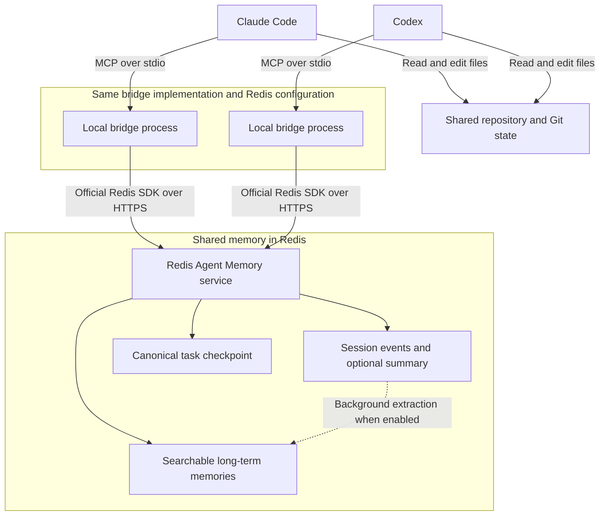

# Technical handoff guide

[Back to README](../README.md)

For the user-facing walkthrough, see the [README use cases](../README.md#use-cases).

## Configure shared context

The examples here use the optional local bridge. For a direct native connection, follow the [native handoff workflow](native-tools.md#handoff-using-native-tools).

Connect both clients to the same Redis Agent Memory endpoint and store, with matching owner and namespace settings. Use a stable session ID for each task, such as `checkout-retry-123`. Configure separate namespaces for different projects. Owner and namespace filters organize retrieval and do not replace service authentication or authorization.

Both agents need access to the relevant repository and files. Memory records describe the work but do not transfer files or running processes.

## Scope compatibility

Capture and imports use the native MCP `namespace` label from `.memory-capture.json` (or the project-path fallback). They do **not** use `AGENT_MEMORY_NAMESPACE_ID` or `AGENT_MEMORY_NAMESPACE` to select their namespace. Bridge tools prefer a namespace resource ID (`namespaceId` / `AGENT_MEMORY_NAMESPACE_ID`), then fall back to a legacy namespace label (`namespace` / `AGENT_MEMORY_NAMESPACE`). These fields are not interchangeable.

To search captured or imported messages through the bridge, use the same owner and legacy namespace label, with no namespace resource ID configured on that bridge connection. If the server has a default resource ID, passing a legacy `namespace` argument does not override it. Alternatively, query the native endpoint directly with the capture owner's `owner_id` and `namespace`. Confirm the resolved capture scope with `status`; matching credentials alone is not enough.

The Claude browser form and MCPB extension default their legacy namespace to `claude-desktop`; project capture usually derives a different label. Set an explicit shared label when these workflows should search the same memories. Different stores, owners, or namespace fields can produce successful searches with no matching results.

Choose a unique bridge `sessionId` per task within a shared store, for example `checkout-alex-retry-123`. Session reads take the session ID directly and do not add owner or namespace filters. Checkpoint IDs include owner, namespace, and session, but that does not isolate the ordered session history. New capture derives a Redis session ID from owner, namespace, and client/conversation identity. An explicit `sessionId` in `.memory-capture.json` is a task alias shared across clients within that owner/project; it is hashed rather than used literally. Use the resolved session ID printed by startup recall or a capture record’s `session_id` with `memory_get_session` and `resume_context`. Imports and manually chosen bridge sessions remain separate. See [session capture](session-capture.md).

## Save and resume with the bridge

Ask the first agent to record important progress with `memory_append` and save a checkpoint with `checkpoint_save`. Include the goal, decisions, completed work, blockers, next steps, repository path, branch, changed files, and test results.

Example prompts:

> **In Claude Code:** Work on checkout retries using memory session `checkout-retry-123`. Record important progress and save a checkpoint after each milestone, including the repository path, branch, changed files, test results, and next steps.

> **In Codex:** Call `resume_context` for session `checkout-retry-123` with query "checkout retries, decisions, tests, blockers, and next steps". Inspect the repository and current Git state, then continue from the latest checkpoint.

`resume_context` retrieves the checkpoint, session history, and relevant long-term memories. When retrieving the original conversation events directly, request `memory_get_session` with `includeSummarisedEvents: true`.

For decisions across related tasks, use `memory_search` within the same owner and project namespace. Long-term search can find captured and imported messages, explicit checkpoints, and facts extracted asynchronously from ordered session events, provided the scope matches. Session events are not searchable as long-term memories until extraction has produced those records.

Save regularly: if a usage limit interrupts an agent before its next checkpoint, the next agent can recover only what was already saved and the files available in the shared working tree.

## Architecture

Capture hooks and optional native tools share long-term memory through the native endpoint:



The optional bridge adds session history and structured resume tools through the Redis SDK:



Each client launches its own local bridge process. Both processes use the same Redis Agent Memory endpoint and store, with matching owner and namespace settings. A shared task session ID links the work across clients.

`memory_append` writes session events. `checkpoint_save` writes or updates a deterministic long-term memory record for the task. `resume_context` fetches that checkpoint directly, retrieves session history, and searches for relevant long-term memories in parallel.

The MCP bridge records content agents send through its tools. The default-enabled [capture hooks](automatic-capture.md) save submitted prompts and available final responses without tool calls by the model. Neither mechanism detects exhausted credits, switches clients, or transfers hidden reasoning. Share or synchronize the working tree separately.

## Test the Claude-to-ChatGPT handoff

Run `npm ci`, configure `AGENT_MEMORY_BASE_URL`, `AGENT_MEMORY_STORE_ID`, and `AGENT_MEMORY_API_KEY` in your environment or `.env`, then run:

```sh
npm run test:e2e:handoff
```

This live integration test builds and extracts the Claude MCPB and ChatGPT Desktop plugin archives. It writes a unique session event and long-term checkpoint through Claude's bundled MCP server, shuts that process down, then retrieves the exact event, searches for the checkpoint, and verifies `resume_context` through a separate ChatGPT plugin server process. Search indexing is allowed up to 60 seconds to become visible. Missing credentials fail the test rather than silently skipping it.

Use a test store and an API key that permits reading, writing, and deleting test records. Each run uses a unique session and owner, preserves your configured namespace, and removes its session and checkpoint afterward. If automatic promotion is enabled, Redis may create additional derived memories; use a disposable store when testing that configuration.

This tests the packaged MCP integrations against real Redis, without opening Claude or ChatGPT or testing model tool selection. It verifies explicit checkpoint persistence and retrieval; it does not wait for background promotion of conversation events into long-term memory. The regular `npm test` suite remains independent of live credentials.

## Verify the installed desktop clients

Run this manual check separately from the packaged integration test. Record each client version, installed plugin version, execution mode, effective owner/namespace, and the actual tool used. Use an isolated test owner or disposable store and non-sensitive test content.

1. Configure the installed Claude and ChatGPT integrations to use the same Redis endpoint, store, owner, and namespace. Capture namespaces are string namespaces; do not put one in `AGENT_MEMORY_NAMESPACE_ID`, which selects a namespace reference. See [scope compatibility](#scope-compatibility).
2. In a configured local Claude Code session in Claude Desktop, submit a fictional decision with a fresh verification code, such as a retry limit and a random identifier. Ask Claude to acknowledge it without running tools or changing files. Check capture status for delivery acknowledgement and an empty queue, then independently retrieve the exact record. This establishes automatic capture; a model-written checkpoint alone does not.
3. Open a fresh local Codex chat in ChatGPT Desktop in the configured project. Where available, select Codex from the ChatGPT dropdown, choose **Work in → This computer**, and use **⌘O** on macOS to open the folder. If these controls are absent, record that limitation and the app version instead of substituting a terminal or cloud chat. See OpenAI's [environment guide](https://learn.chatgpt.com/docs/environments/modes) and [desktop shortcuts](https://learn.chatgpt.com/docs/reference/commands).
4. Ask the fresh chat to call the Redis bridge's `memory_search` tool for the latest fictional decision and return its limit and exact verification code. Identify the Redis server explicitly if other memory integrations are installed. Keep the expected answer and verification code out of this prompt, and ask it not to inspect files or earlier chats.
5. Inspect the visible tool call and result. Pass only when the intended Redis server returns the saved record and the answer matches both fields. `agentmemory.memory_smart_search` belongs to the separate agentmemory service and does not verify this Redis bridge. A Codex terminal screenshot establishes interactive CLI behavior; desktop evidence must come from the desktop chat.
6. In another fresh desktop chat, repeat the question without requesting a tool call. Inspect capture diagnostics to determine whether startup/per-prompt hooks supplied the record. Record this as a separate automatic-recall result; explicit MCP search does not establish hook activation. Verify a new desktop prompt/response is delivered as well before claiming automatic saving on that surface.

Keep screenshots or redacted tool traces with the result. A correct answer reported by a tester without its tool trace is user-reported evidence, not direct observation of server selection. Clean up only records created for the test after validation is complete.

### Diagnose an unavailable tool

- Confirm the intended server is enabled in the project and start a fresh client session after configuration changes. Codex loads project configuration only in trusted projects; see [configuration basics](https://learn.chatgpt.com/docs/config-file/config-basic).
- A server appearing in `codex mcp list` establishes configuration discovery, not successful startup. Check the MCP startup error and run `memory_health` through that client.
- For a stdio server, verify the configured executable and bundled server path both exist. Resolve Node with `node -p process.execPath`; do not assume `/opt/homebrew/bin/node` exists when Node is installed through a version manager.
- If a search is empty, compare owner, namespace versus namespace reference, endpoint, and store before changing the query or similarity threshold. Keep credentials in private settings, outside chat and screenshots.
- When context is truncated, repeat with the normal configured budgets or retrieve the relevant details explicitly. A strict size cap can preserve the decision while omitting its verification code; bounded output alone is not a successful exact-recall test.

### Acceptance evidence from October 16, 2026

The v0.1.7 packaged integrations passed against live Redis after correcting the stale duplicate-checkpoint assertion in [PR #62](https://github.com/alberttwong/Redis-Agent-Memory-for-Claude-and-ChatGPT/pull/62). Direct checks also verified queue retention during a process-local connection failure, retry delivery, linked-worktree scope identity, bounded startup/per-prompt recall, and capture/delivery/recall diagnostics.

Claude Desktop local Code with plugin v0.1.9 automatically captured a test decision. A fresh desktop session recalled the decision and exact code using default context budgets. A deliberately reduced 1,024-character budget preserved the limit but truncated the code. An interactive Codex CLI screenshot showed the correct Redis tool and matching answer. The tester subsequently reported the same exact answer for the requested desktop check; no desktop tool-call screenshot was supplied, so ChatGPT desktop server selection and its automatic capture/recall hooks remain unverified.

