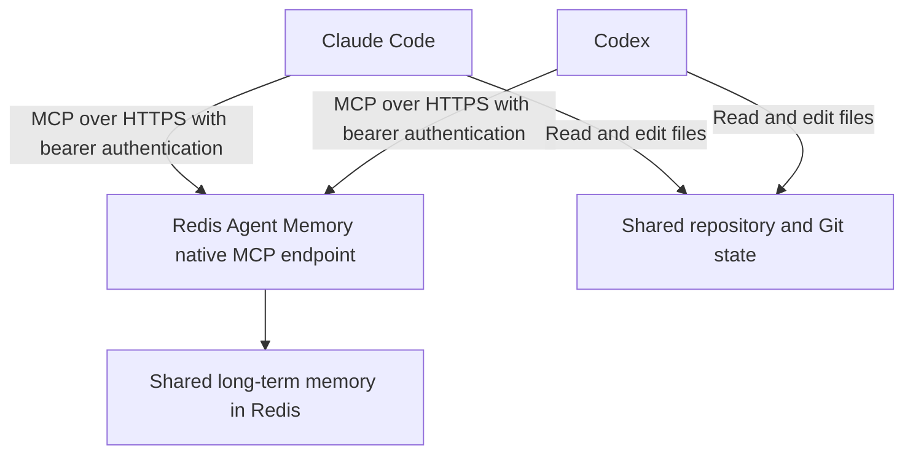
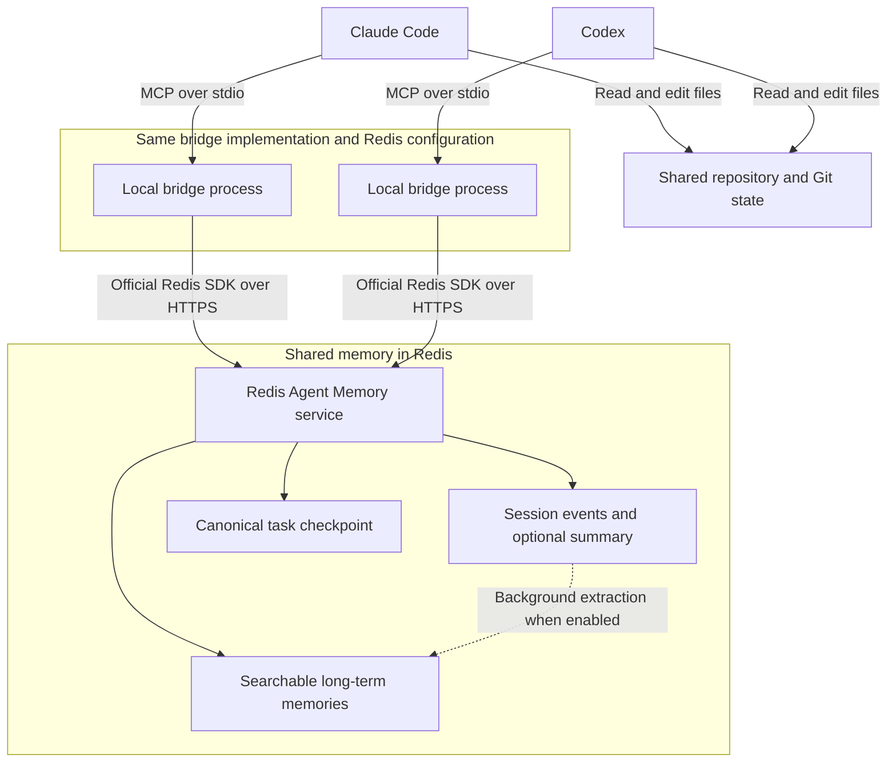

# Technical handoff guide

For the user-facing walkthrough, see the [README use cases](../README.md#use-cases).

## Configure shared context

The examples here use the optional local bridge. For a direct native connection, follow the [native handoff workflow](native-tools.md#handoff-using-native-tools).

Connect both clients to the same Redis Agent Memory endpoint and store, with matching owner and namespace settings. Use a stable session ID for each task, such as `checkout-retry-123`. Configure separate namespaces for different projects. Owner and namespace filters organize retrieval and do not replace service authentication or authorization.

Both agents need access to the relevant repository and files. Memory records describe the work but do not transfer files or running processes.

## Save and resume with the bridge

Ask the first agent to record important progress with `memory_append` and save a checkpoint with `checkpoint_save`. Include the goal, decisions, completed work, blockers, next steps, repository path, branch, changed files, and test results.

Example prompts:

> **In Claude Code:** Work on checkout retries using memory session `checkout-retry-123`. Record important progress and save a checkpoint after each milestone, including the repository path, branch, changed files, test results, and next steps.

> **In Codex:** Call `resume_context` for session `checkout-retry-123` with query "checkout retries, decisions, tests, blockers, and next steps". Inspect the repository and current Git state, then continue from the latest checkpoint.

`resume_context` retrieves the checkpoint, session history, and relevant long-term memories. When retrieving the original conversation events directly, request `memory_get_session` with `includeSummarisedEvents: true`.

For decisions across related tasks, use `memory_search` within the same owner and project namespace. Relevant long-term memories become available across sessions after Redis has extracted them, or when explicitly saved as checkpoints.

Save regularly: if a usage limit interrupts an agent before its next checkpoint, the next agent can recover only what was already saved and the files available in the shared working tree.

## Architecture

The recommended direct connection shares long-term memory through the native endpoint:



The optional bridge adds session history and structured resume tools through the Redis SDK:



Each client launches its own local bridge process. Both processes use the same Redis Agent Memory endpoint and store, with matching owner and namespace settings. A shared task session ID links the work across clients.

`memory_append` writes session events. `checkpoint_save` writes or updates a deterministic long-term memory record for the task. `resume_context` fetches that checkpoint directly, retrieves session history, and searches for relevant long-term memories in parallel.

The MCP bridge records content agents send through its tools. The default-enabled [capture hooks](automatic-capture.md) save submitted prompts and available final responses without tool calls by the model. Neither mechanism detects exhausted credits, switches clients, or transfers hidden reasoning. Share or synchronize the working tree separately.

## Test the Claude-to-ChatGPT handoff

Run `npm ci`, configure `AGENT_MEMORY_BASE_URL`, `AGENT_MEMORY_STORE_ID`, and `AGENT_MEMORY_API_KEY` in your environment or `.env`, then run:

```sh
npm run test:e2e:handoff
```

This live integration test builds and extracts the Claude MCPB and ChatGPT Desktop plugin archives. It writes a unique session event and long-term checkpoint through Claude's bundled MCP server, shuts that process down, then retrieves the exact event, searches for the checkpoint, and verifies `resume_context` through a separate ChatGPT plugin server process. Search indexing is allowed up to 60 seconds to become visible. Missing credentials fail the test rather than silently skipping it.

Use a test store and an API key that permits reading, writing, and deleting test records. Each run uses a unique session and owner, preserves your configured namespace, and removes its session and checkpoint afterward. If automatic promotion is enabled, Redis may create additional derived memories; use a disposable store when testing that configuration.

This tests the packaged MCP integrations against real Redis, without opening Claude or ChatGPT or testing model tool selection. It verifies explicit checkpoint persistence and retrieval; it does not wait for background promotion of conversation events into long-term memory. The regular `npm test` suite remains independent of live credentials.

